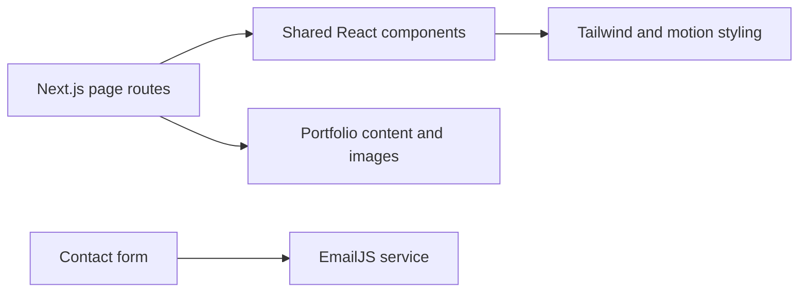

# Sree Chand Nadella · Portfolio

**A personal website for presenting engineering work, experience, and publications.**

Next.js · React · Tailwind CSS · Framer Motion · EmailJS

## About this project

This repository contains the portfolio website for **Sree Chand Nadella**. It brings a professional introduction, selected projects, experience, publications, and a contact form into a consistent interface.

The site content belongs to the named portfolio subject. The repository is maintained under [Balaji91221](https://github.com/Balaji91221).

## Pages and features

- Animated introduction and profile presentation.
- Project cards with images and descriptions.
- Dedicated experience and publications pages.
- Contact form that sends through EmailJS.
- Shared navigation, layout, footer, and theme styling.

## Run locally

Open the source directory with Node.js/npm installed:

```bash
npm install
npm run dev
```

Open [localhost:3000](http://localhost:3000). The package also defines `npm run build`, `npm start`, and `npm run lint`.

## Contact form setup

Configure these public EmailJS identifiers in `.env.local` for your own EmailJS service:

- `NEXT_PUBLIC_SERVICE_ID`
- `NEXT_PUBLIC_TEMPLATE_ID`
- `NEXT_PUBLIC_PUBLIC_USER_ID`

The form implementation is in [`src/pages/contact.jsx`](src/pages/contact.jsx). Its template parameters include name, email, phone, subject, and message. Configure the matching template in EmailJS before relying on message delivery.

## Architecture



## Edit the portfolio

| Location | Content |
|---|---|
| [`src/pages/index.jsx`](src/pages/index.jsx) | Introduction and profile links |
| [`src/pages/projects.jsx`](src/pages/projects.jsx) | Project cards |
| [`src/pages/experience.jsx`](src/pages/experience.jsx) | Work experience |
| [`src/pages/publications.jsx`](src/pages/publications.jsx) | Publications |
| [`src/components/`](src/components/) | Reusable layout and interface pieces |
| [`src/images/`](src/images/) | Portrait and project assets |

Some project links in the source remain placeholders. Replace them with the appropriate destinations when adapting the site.

## Contact and license note

Portfolio contact: [sreechand.nadella@gmail.com](mailto:sreechand.nadella@gmail.com).

The earlier project documentation states MIT, but the repository currently has no standalone `LICENSE` file.
